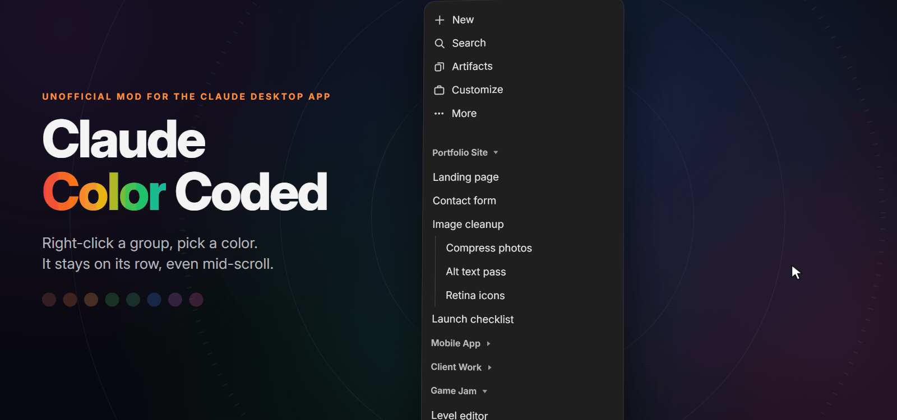
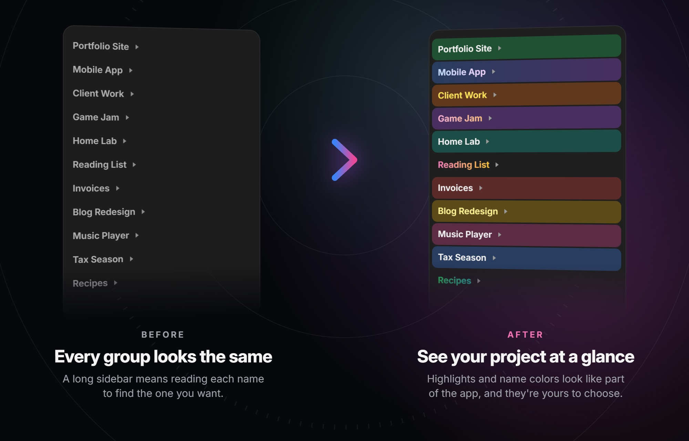
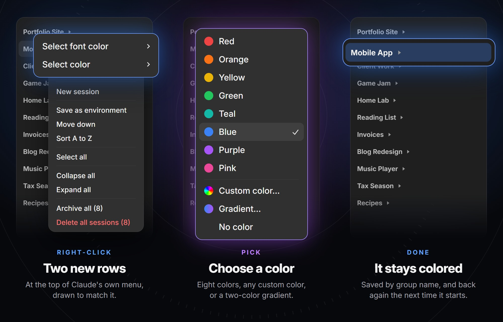
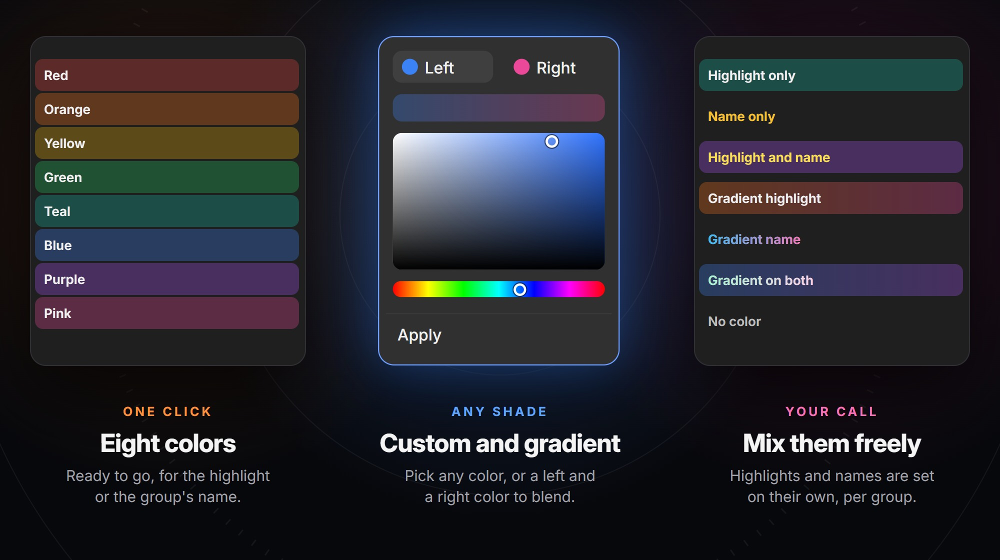
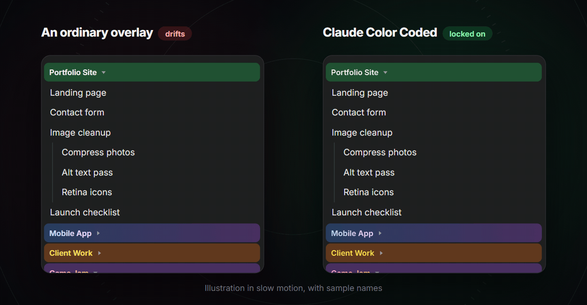
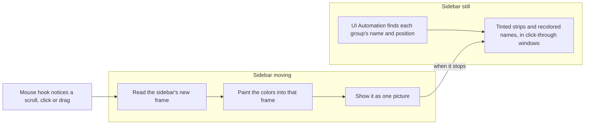

<p align="center"></p>

<p align="center">
  
  
  
  
  <a href="LICENSE"></a>
</p>

<p align="center">
  <b>Color-code the sidebar of the Claude desktop app.</b><br>
  Right-click a group, pick a highlight or a name color, and find your projects at a glance.<br>
  Solid colors or gradients, and they stay on their rows even mid-scroll.
</p>

<p align="center">
  <a href="#install">Install</a> ·
  <a href="#use-it">Use it</a> ·
  <a href="#colors">Colors</a> ·
  <a href="#why-it-stays-on">Why it stays on</a> ·
  <a href="#update-or-uninstall">Update or uninstall</a> ·
  <a href="#troubleshooting">Troubleshooting</a> ·
  <a href="#what-it-can-see">What it can see</a>
</p>



<sub>The pictures here are recreations with sample names, because a real sidebar would show real project names. Their colors and sizes are the program's own.</sub>

## Install

You need 64-bit Windows and the Claude desktop app. You don't need admin rights.

A one-line install through `winget`, Windows' own package manager, is planned. For now, you build it yourself with the C# compiler that comes with Windows:

```powershell
git clone https://github.com/CodySpooner/Claude-Color-Coded.git
cd Claude-Color-Coded
.\build.cmd
.\ClaudeColorCoded.exe
```

If you don't have Git, choose **Code > Download ZIP** at the top of this page, extract it, open that folder in PowerShell, and run the last two lines.

There's no window to open, only an icon in the system tray. To quit, right-click that icon.

To have it start when you sign in, type `shell:startup` into File Explorer's address bar and put a shortcut to `ClaudeColorCoded.exe` in the folder that opens.

## Use it



1. Open the **Code** tab in Claude, with the sidebar showing.
2. Right-click a group heading. **Select font color** and **Select color** appear at the top of the menu.
3. Click one and choose a color.

Your colors are saved by group name and come back each time it starts. To remove one, choose **No color**.

## Colors



| Choice | What you get |
| --- | --- |
| **Eight colors** | Red, orange, yellow, green, teal, blue, purple or pink |
| **Custom color…** | A color picker, for any shade |
| **Gradient…** | A left and a right color, blended across the row or the name |
| **No color** | Takes the color off |

**Select color** sets a group's highlight, and **Select font color** sets the color of its name. Each group can have either or both. Font colors apply to group names only, not to the sessions under them.

## Why it stays on



A window drawn over an app always lands a frame or two behind it, so ordinary overlays slide off their text as you scroll. This one doesn't draw over the sidebar while it moves. It reads each new frame, paints the colors into that frame, and shows the result as one picture, so text and color can't separate. Clicks still pass through to the app.

| Tested with a real mouse | Result |
| --- | --- |
| Scrolling with the wheel | 15 of 15 scrolls landed exactly, and the highlight's distance from its text never changed in 4,268 measurements |
| Expanding and collapsing groups | No wrong pictures in 1,156 frames |
| Stopping in the middle of a scroll | 12 of 12 ended in the right place |
| Moving the window | 6 ms behind the cursor, compared with 2–3 ms with no helper running |

These come from one PC: Windows 11, dark mode, 100% scaling, a 165 Hz screen. The cost is that an expand or collapse appears about 100 ms after the click, because the picture waits until the new row positions match what's on screen.

## Update or uninstall

**To update,** quit it from the tray icon, run `git pull` and `.\build.cmd` in its folder, then start it again. If you used the ZIP, download a new one instead. Your colors stay.

**To uninstall,** quit it from the tray icon, then delete its folder and any shortcut you made. Your saved colors are in `%LOCALAPPDATA%\ClaudeColorCoded`, so delete that folder too if you don't want them.

It never changes Claude's own files, so there's nothing to undo in the app.

## Troubleshooting

- **The color rows don't appear:** check that the tray icon is there and that you're right-clicking a group heading, not a session. Then run the check below.
- **It stopped working after a Claude update:** it relies on the app's English `New session in <name>` button label and one of its class names, so an update or another display language can break it. Run this in its folder. It lists the headings it can read, or says what failed:

  ```powershell
  .\ClaudeColorCoded.exe --check | Out-String
  ```

- **Windows or your antivirus blocks it:** please don't override a warning you're unsure about. [Open an issue](https://github.com/CodySpooner/Claude-Color-Coded/issues) instead, so it can be looked at. The program isn't code-signed, and it uses a mouse hook and reads the screen, which security software can question. The whole program is one file, [`claude-color-coded.cs`](claude-color-coded.cs), if you want to read it.
- **The app's menu stays open after you pick a color:** this happens now and then, and clicking elsewhere closes it.

## What it can see

This is a separate program, not a plugin, and it doesn't change the app's files. The program makes no network connections.

| It uses | For | What's kept |
| --- | --- | --- |
| **Windows UI Automation**, the API screen readers use | Finding each heading's name and position. The app's accessibility tree also holds chat text, which is only compared against a button label. | Nothing |
| **A system-wide mouse hook** | Noticing right-clicks on headings, clicks and scrolling in the sidebar, and window drags. | Nothing is recorded |
| **Screen pixels** | For about a third of a second after each scroll or click in the sidebar, the area the sidebar covers, including any other window overlapping it. Also the open menu, to match its colors, and each colored name with Claude in front, to draw it. | Held in memory and only redrawn in place. The program never saves them, but if it crashes, Windows may write its memory to a crash file on your PC. |
| **Two text files** in `%LOCALAPPDATA%\ClaudeColorCoded` | `colors.txt` and `font-colors.txt` hold your group names and their colors. | Until you delete them |

## Limits

<details>
<summary><b>Show all the known limits</b></summary>
<br>

- It has only been tested on Windows 11 in dark mode. Sizes assume 100% display scaling, and scrolling was tested on a 165 Hz screen.
- Screen recordings and screenshots taken during a scroll, or just after a click in the sidebar, don't show the colors. Its windows are hidden from capture for that moment so they aren't read back into the picture. At rest they show as normal.
- On a rotated screen it uses an older, slower way of reading the screen, so scrolling there may look less smooth. That way was tested on a normal screen, where colors stayed attached, but not on a rotated one.
- A heading that newly appears can take up to 5 seconds to get its colors, or until the next click that moves rows in the sidebar.
- HDR hasn't been tested. The picture's colors could differ slightly from the resting ones there, showing as a small change when scrolling starts and stops.
- A colored name is first drawn once Claude is in front with its sidebar still, so a new font color may wait until then.
- If you click in the sidebar and turn the wheel within about 100 ms, the colors can be off until that scroll stops.
- The app's in-window pop-ups aren't detected, so one that overlaps the sidebar has the colors drawn on top of it.
- The color rows open on click rather than hover, and the app's arrow keys can't reach them.
- Picking a color closes the app's menu by sending it the Esc key. If that menu closes by itself in the same instant, the key reaches the app instead, where it could stop a running session.
- For a heading at the very top of the screen, the color rows cover part of the app's first menu item. Scrolling down a little frees it.
- The color picker is mouse-only, so you can't type a hex code.
- Colors follow a group's name, so a group whose name changes loses its colors.
- While the sidebar straddles two screens, the part on the other screen has no colors.

</details>

## How it works



The color rows are another window, drawn to look like part of the app's menu. After a click that expands or collapses a group, each frame is checked against the row positions, and the new layout only goes up once they agree.

## Repository layout

```
Claude-Color-Coded/
├── build.cmd                compiles it with the C# compiler that comes with Windows
├── claude-color-coded.cs    the whole program
├── packaging/               the installer script and the winget package files
└── docs/
    ├── showcase.html        draws this README's pictures, with sample names
    ├── make-pictures.mjs    turns those into image files
    └── images/              the pictures in this README
```

## Development

`main` is the published version, and `development` is where changes are made and proven first.

After a change, build it and run its self-check. Quit the running copy first, because Windows locks the file while it runs:

```powershell
.\build.cmd
.\ClaudeColorCoded.exe --check | Out-String
```

To make the installer, build it, then compile `packaging/claude-color-coded.iss` with [Inno Setup](https://jrsoftware.org/isinfo.php).

To redraw the pictures, which needs Node 24, Chrome or Edge, and ffmpeg:

```powershell
node docs/make-pictures.mjs
```

---

<p align="center">Made by <a href="https://github.com/CodySpooner">Xody</a> · <a href="LICENSE">MIT license</a><br><sub>An unofficial community project, not made by or affiliated with Anthropic.</sub></p>
